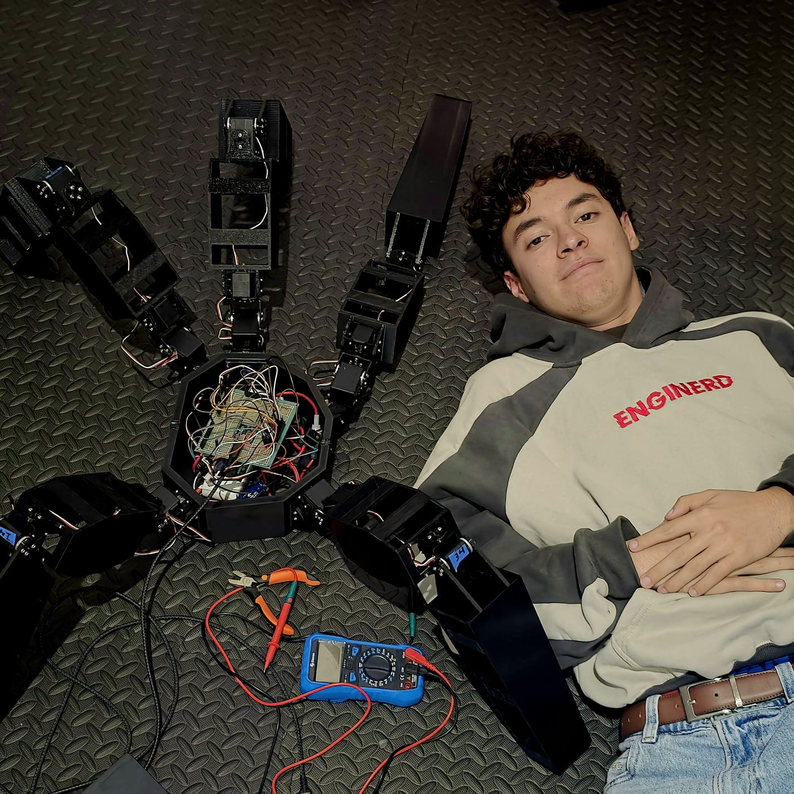
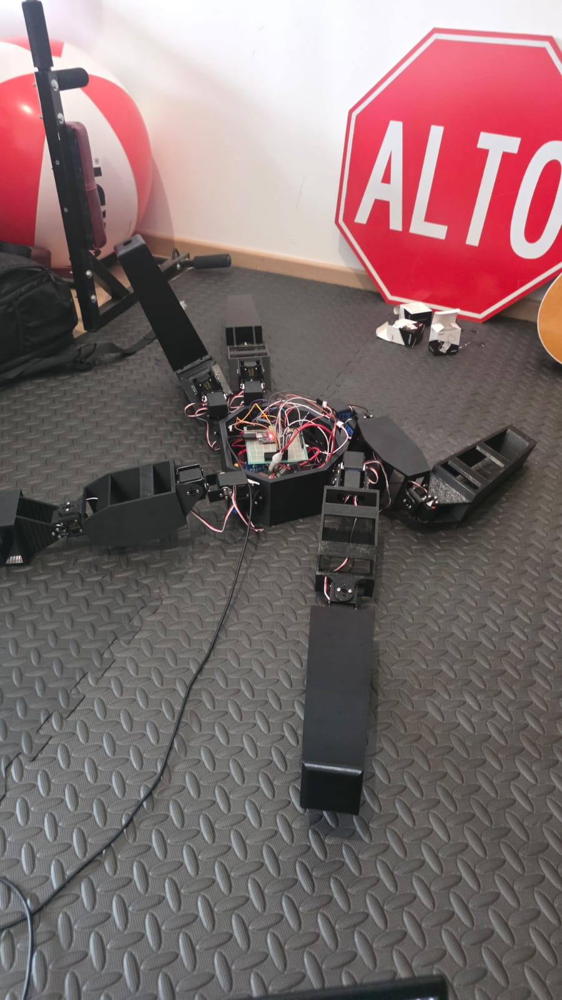
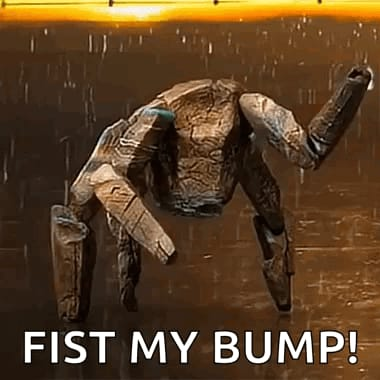

# Rocky

**A custom, 3D-printable robot built around Feetech STS3215 smart serial bus servos.**

  
  

Rocky is a work-in-progress robotics project. This repository contains the SolidWorks part and assembly files, along with mesh exports for 3D printing.

## Project files

| Folder | Contents |
| --- | --- |
| [`solid/solidworks/`](solid/solidworks/) | Editable SolidWorks parts (`.SLDPRT`) and assemblies (`.SLDASM`) |
| [`solid/print-ready/`](solid/print-ready/) | 3D-printable mesh exports (`.STL` and `.3mf`) |
| [`assets/images/`](assets/images/) | Project photos |

All SolidWorks parts and assemblies are kept together so their relative component references are less likely to break. Open [`FullRocky.SLDASM`](solid/solidworks/FullRocky.SLDASM) for the full assembly.

## Important models

- **`FullRocky.SLDASM`** — full robot assembly.
- **`ArmAssembly.SLDASM`** and **`ArmAssembly2.SLDASM`** — arm assemblies.
- **`Cuerpo.SLDPRT`** and **`Tapa*.SLDPRT`** — body and enclosure parts.
- **`STS3215_*.SLDPRT`** — brackets designed for STS3215 servos.
- **`Leg-End*`** — leg-end designs and print exports.

## About older variants

Files with names such as `V2`, `V3`, `v2`, or numbered suffixes appear to be design iterations. They are kept rather than labeled as junk: a similarly named file is not necessarily a duplicate, and an older part may still be referenced by an assembly. Check references and compare geometry in SolidWorks before removing any.

## Formats

- **SolidWorks:** `.SLDPRT` part files and `.SLDASM` assembly files.
- **Print exports:** `.STL` and `.3mf` mesh files.

## Workshop spirit

  

